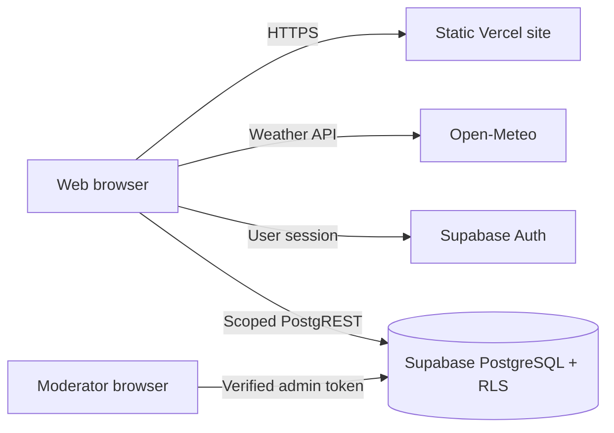

# System Architecture

PowerGuard is a static browser application deployed on Vercel. Browser modules
fetch weather and search cities through Open-Meteo, and connect directly to
Supabase Auth/PostgreSQL for authenticated contributions.

## Components

- `src/risk.js`: pure risk and forecast analysis.
- `src/weather.js`: city search, Open-Meteo access and sample-mode fallback.
- `src/backend.js`: safe browser authentication and Supabase interactions.
- `src/main.js`: dashboard, navigation, checklist and observation forms.
- `src/moderation.js`: reviewer-only signal verification tools.
- `src/config.js`: *public* project ID / publishable key (never service-role).

No privileged API key is embedded in the frontend. Supabase RLS enforces
permissions server-side. Changes to the hosted build require a new deployment.
