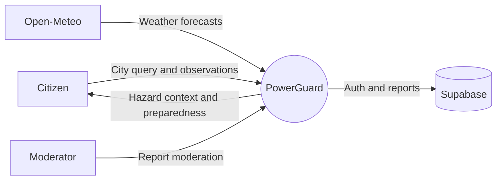
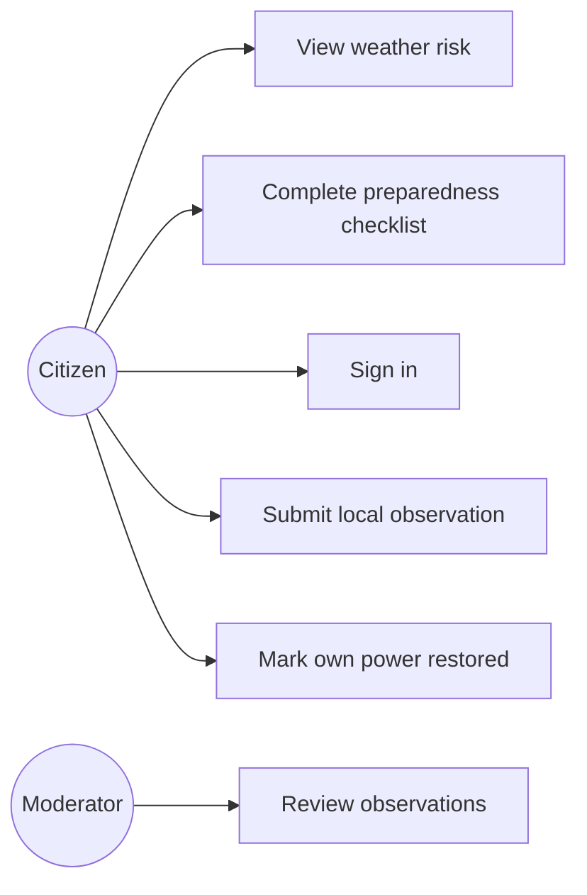
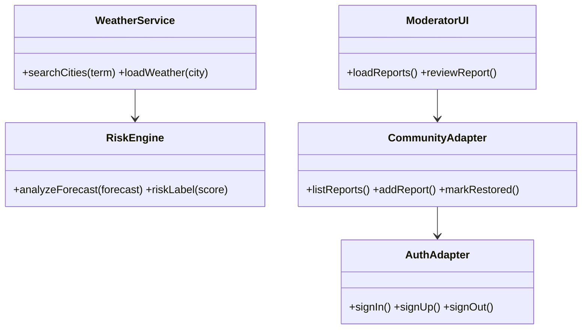
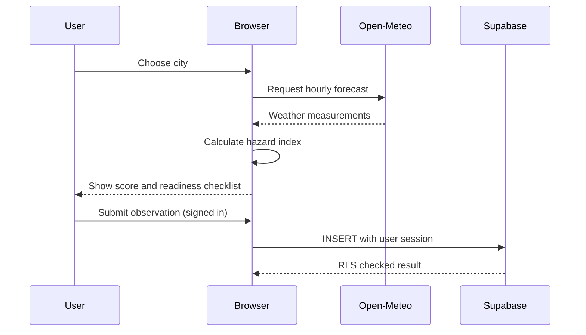
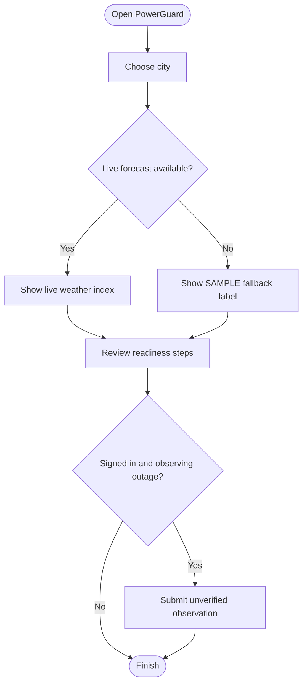

# Software Engineering Diagrams

## Context-level Data Flow Diagram

## Use Case Diagram (UML-style)

## Class Diagram

## Sequence Diagram

## Activity Diagram

These editable diagrams are conceptual representations for coursework and
should be reviewed against the live implementation before submission.
